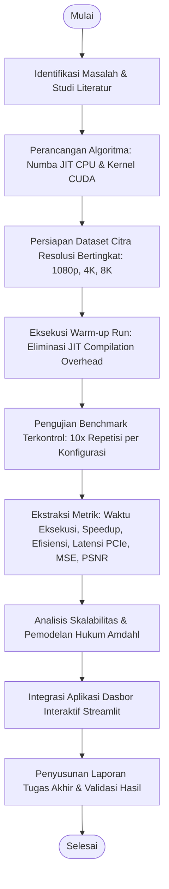

# PROPOSAL TUGAS AKHIR

<div align="center">

## ANALISIS PERFORMANSI KOMPUTASI PARALEL
### PADA FILTER KONVOLUSI CITRA RESOLUSI TINGGI MENGGUNAKAN
### CPU *MULTI-CORE* DAN GPU CUDA

<br>

*Diajukan sebagai salah satu syarat untuk melaksanakan Seminar Proposal*  
*pada Program Studi Rekayasa Sistem Komputer*  
*Fakultas Matematika dan Ilmu Pengetahuan Alam*  
*Universitas Tanjungpura*  
*Pontianak*

<br>

**Disusun Oleh:**  
**Windra Maxwall Dari Natalius**  
**NIM. H1051241073**

<br>

**PROGRAM STUDI REKAYASA SISTEM KOMPUTER**  
**FAKULTAS MATEMATIKA DAN ILMU PENGETAHUAN ALAM**  
**UNIVERSITAS TANJUNGPURA**  
**PONTIANAK**  
**2026**

</div>

---

## A. JUDUL PENELITIAN

**ANALISIS PERFORMANSI KOMPUTASI PARALEL PADA FILTER KONVOLUSI CITRA RESOLUSI TINGGI MENGGUNAKAN CPU *MULTI-CORE* DAN GPU CUDA**

---

## B. BIDANG PENELITIAN DAN MATA KULIAH PILIHAN PENDUKUNG

*   **Bidang Penelitian:** Rekayasa Perangkat Keras, Arsitektur Sistem Komputer, dan Komputasi Cerdas.
*   **Mata Kuliah Pilihan Pendukung:**
    1.  Pengolahan Citra Digital (Semester Ganjil / 3 SKS)
    2.  Sistem Terdistribusi dan Komputasi Paralel (Semester Genap / 3 SKS)
    3.  Arsitektur dan Organisasi Sistem Komputer Lanjut (Semester Ganjil / 3 SKS)

---

## C. LATAR BELAKANG

Pemrosesan citra digital beresolusi ultra-tinggi seperti *Full HD* 1080p (1920x1080 piksel), 4K (3840x2160 piksel), hingga 8K (7680x4320 piksel) kini dijumpai pada berbagai domain, mulai dari pencitraan medis hingga pemantauan satelit geospasial. Operasi konvolusi matriks dua dimensi merupakan operasi dasar pada ekstraksi fitur, *sharpening*, peredaman derau *Gaussian blur*, serta deteksi tepi *Sobel*. Namun, pada citra 8K yang memuat lebih dari 33,17 juta piksel, operasi konvolusi spasial membutuhkan ratusan juta perkalian dan penjumlahan akumulatif. Pemrosesan sekuensial pada CPU *single-core* tradisional membutuhkan waktu eksekusi yang lama, sehingga tidak memenuhi kebutuhan pemrosesan waktu-nyata.

Akasapu, Sailaja, dan Prasad (2021) mengimplementasikan filter deteksi tepi Sobel berbasis CUDA pada GPU, di mana pemanfaatan ribuan *thread* secara serentak memangkas waktu eksekusi dibandingkan komputasi CPU sekuensial. Asaduzzaman, Jojigiri, Sabu, dan Tailam (2021) menganalisis rasio antara waktu komputasi murni dengan waktu transfer memori pada kartu GPU. Hasil analisis tersebut memperlihatkan bahwa transfer data antara memori *host* dan memori *device* melalui bus PCIe berkontribusi terhadap latensi total akselerator. Diana, Agustina, Situmorang, Kholid, dan Pratama (2026) membandingkan operator Sobel, Prewitt, dan Canny pada 20 citra uji dari basis data USC-SIPI menggunakan *Mean Squared Error* (MSE), PSNR, F-*measure*, serta waktu komputasi. Operator Canny memperoleh MSE rata-rata terendah sebesar 7,26 dan PSNR tertinggi 40,06 dB, namun menanggung biaya komputasi tiga hingga empat kali lipat dibandingkan operator Sobel dan Prewitt yang berkisar 2,4 milidetik. Temuan tersebut memperlihatkan adanya *trade-off* antara akurasi deteksi dan beban komputasi.

Pada peningkatan resolusi citra, Thévenaz, Blu, dan Unser (2000) merumuskan kerangka teoretik interpolasi citra digital yang menekankan bahwa pemilihan fungsi basis interpolasi menentukan keseimbangan antara akurasi pemulihan sinyal dan beban komputasi. Kerangka tersebut memperkenalkan evaluasi kesalahan interpolasi berbasis kesalahan kuadrat rata-rata. Ruijters dan Thévenaz (2012) mengimplementasikan prafilter interpolasi *cubic B-spline* pada GPU CUDA, yang memperlihatkan bahwa metode interpolasi orde tinggi yang sebelumnya hanya layak dijalankan pada CPU dapat dipercepat melalui rekursi kausal dan anti-kausal yang dipetakan ke ribuan *thread* GPU.

Beberapa penelitian terdahulu hanya membandingkan performa secara polar antara CPU 1 *core* dengan GPU, tanpa membedah skalabilitas bertingkat pada CPU *multi-core* dengan alokasi 1, 2, 4, hingga 8 *core* berdasarkan Hukum Amdahl. Kajian interpolasi citra seperti Thévenaz dkk. (2000) dan Ruijters serta Thévenaz (2012) berfokus pada akurasi pemulihan sinyal, namun belum membandingkan keluaran antarmetode interpolasi secara kuantitatif terhadap referensi pada konfigurasi pemroses yang bervariasi. Evaluasi yang menggabungkan kedua aspek tersebut, yaitu kedekatan keluaran dan waktu eksekusi hingga resolusi 8K, belum dipetakan, terutama ambang batas peralihan antara penalti transfer memori *host-to-device* dengan akselerasi *kernel* GPU.

Sebagai solusi atas permasalahan tersebut, penelitian ini mengusulkan analisis performansi dan perancangan kerangka komputasi paralel heterogen untuk filter konvolusi citra resolusi bertingkat (1080p, 4K, dan 8K), sekaligus operasi *upscaling* dari 1080p ke 4K dan dari 4K ke 8K. Kerangka kerja ini dibangun menggunakan teknik kompilasi *Just-In-Time* (JIT) Numba pada arsitektur CPU *multi-core* dengan alokasi 1, 2, 4, dan 8 *core*, serta kernel paralel pada arsitektur GPU NVIDIA CUDA (RTX 3050). Pemilihan solusi ini didasarkan pada kemampuan Numba JIT melepaskan *Global Interpreter Lock* (GIL) Python selama eksekusi kernel terkompilasi dan kemampuan CUDA mengeksekusi operasi konvolusi dua dimensi melalui ribuan *thread* yang terpetakan ke dalam *grid of blocks*.

Hasil penelitian ini berupa tolok ukur kuantitatif mengenai rasio *speedup*, efisiensi komputasi paralel, identifikasi titik jenuh pemrosesan, serta pengaruh latensi transfer memori antarmuka PCIe. Pada operasi *upscaling*, dihasilkan pula pengukuran kedekatan keluaran antarmetode interpolasi terhadap hasil interpolasi *Lanczos* sebagai referensi, yang diukur melalui MSE dan PSNR. Seluruh modul komputasi diintegrasikan ke dalam aplikasi dasbor berbasis web, sehingga pengguna dapat mereplikasi pengujian dan menganalisis performa filter konvolusi citra secara langsung.

---

## D. RUMUSAN MASALAH

Berdasarkan latar belakang masalah yang telah diuraikan, rumusan masalah dalam penelitian ini dirumuskan sebagai berikut:

1.  Bagaimana karakteristik skalabilitas waktu eksekusi dan rasio *speedup* pemrosesan filter konvolusi citra serta operasi *upscaling* citra pada variasi alokasi 1 *core*, 2 *core*, 4 *core*, dan 8 *core* CPU dibandingkan dengan akselerasi masif GPU NVIDIA CUDA?
2.  Pada ambang batas resolusi citra berapakah akselerasi komputasi paralel GPU CUDA mulai efektif melampaui penalti latensi *overhead* transfer memori *host-to-device* melalui antarmuka PCIe jika dibandingkan dengan komputasi CPU *multi-core*?
3.  Berapa tingkat efisiensi paralel (*parallel efficiency*) dan fraksi paralel (*parallel fraction*) berdasarkan Hukum Amdahl pada penambahan jumlah *core* CPU serta *streaming multiprocessor* GPU untuk variasi resolusi citra 1080p, 4K, dan 8K?
4.  Bagaimana tingkat kedekatan keluaran operasi *upscaling* citra dari 1080p ke 4K dan dari 4K ke 8K yang dihasilkan oleh metode interpolasi *Nearest Neighbor*, Bilinear, dan Bicubic terhadap referensi interpolasi *Lanczos* yang diukur menggunakan MSE dan PSNR pada setiap konfigurasi pemroses?

---

## E. BATASAN MASALAH

Agar penelitian ini terarah dan fokus pada substansi yang diuji, batasan masalah ditetapkan sebagai berikut:

1.  Perangkat keras komputasi yang digunakan adalah prosesor Intel Core 5 210H (8 *physical cores*: 4 *Performance-cores* dan 4 *Efficient-cores*, 12 *threads*) dengan memori RAM 16 GB DDR5, serta unit pemroses grafis NVIDIA GeForce RTX 3050 Laptop GPU (6 GB GDDR6 VRAM, arsitektur Ampere *Compute Capability* 8.6). Jumlah *streaming multiprocessor* dan *CUDA cores* dibaca langsung dari perangkat melalui API CUDA saat pengujian, bukan diasumsikan dari deskripsi pabrikan, karena jumlah tersebut berbeda antar varian kartu grafis yang sama.
2.  Resolusi citra uji dibatasi pada tiga tingkatan standar resolusi tinggi: *Full HD* 1080p (1920x1080 piksel / 2,07 megapiksel), 4K UHD (3840x2160 piksel / 8,29 megapiksel), dan 8K UHD (7680x4320 piksel / 33,17 megapiksel). Citra diubah ke mode grayscale 8-bit kemudian diproses dalam matriks presisi tunggal (*float32*) satu kanal.
3.  Operasi spasial konvolusi citra difokuskan pada operator matriks kernel 3x3: filter deteksi tepi Sobel (gradien horizontal *Gx* dan vertikal *Gy*), filter peredam derau *Gaussian Blur* 3x3, dan filter penajaman citra (*Sharpening*) 3x3 dengan matriks `[0, -1, 0; -1, 5, -1; 0, -1, 0]`. Kernel ini berlaku untuk seluruh pengujian CPU, GPU, dan dasbor, sehingga hasil ketiganya dapat dibandingkan langsung.
4.  Operasi peningkatan resolusi (*upscaling*) dibatasi pada pemetaan 1080p ke 4K UHD dan 4K UHD ke 8K UHD menggunakan tiga metode interpolasi, yaitu *Nearest Neighbor*, Bilinear, dan Bicubic (Catmull-Rom), dengan kedekatan keluaran dievaluasi terhadap hasil interpolasi *Lanczos* pada referensi yang sama.
5.  Lingkungan pemrograman menggunakan bahasa Python 3.14 dengan akselerasi kompilasi *Just-In-Time* Numba CPU (*parallel=True* dan *prange*) serta Numba CUDA terintegrasi dengan CUDA Toolkit 13.
6.  Konfigurasi CPU yang diuji dibatasi pada alokasi 1 *core*, 2 *core*, 4 *core*, dan 8 *core* fisik aktif untuk menguji skalabilitas murni komputasi paralel.
7.  Aplikasi pengujian visual dibangun sebagai dasbor interaktif berbasis web menggunakan pustaka Streamlit yang berjalan secara lokal pada sistem komputer pengujian.

---

## F. TUJUAN PENELITIAN

Tujuan yang ingin dicapai melalui pelaksanaan penelitian Tugas Akhir ini adalah:

1.  Menganalisis karakteristik skalabilitas waktu eksekusi dan menghitung rasio percepatan (*speedup*) pemrosesan filter konvolusi citra serta operasi *upscaling* citra pada variasi konfigurasi 1 *core*, 2 *core*, 4 *core*, 8 *core* CPU, dan GPU NVIDIA CUDA.
2.  Menentukan ambang batas resolusi citra di mana akselerasi komputasi paralel GPU CUDA efektif mengungguli penalti latensi transfer memori *host-to-device* melalui bus PCIe.
3.  Mengukur efisiensi komputasi paralel (*parallel efficiency*) dan mengestimasi fraksi paralel berdasarkan Hukum Amdahl pada setiap tingkatan resolusi citra (1080p, 4K, dan 8K).
4.  Mengukur tingkat kedekatan keluaran operasi *upscaling* dari 1080p ke 4K dan dari 4K ke 8K yang dihasilkan oleh metode interpolasi *Nearest Neighbor*, Bilinear, dan Bicubic terhadap referensi interpolasi *Lanczos* menggunakan MSE dan PSNR pada setiap konfigurasi pemroses (CPU 1, 2, 4, 8 *core*, dan GPU).
5.  Mengembangkan aplikasi dasbor pengujian visual interaktif untuk mendemonstrasikan perbandingan performa, analisis grafis, dan visualisasi hasil operasi secara langsung.

---

## G. MANFAAT PENELITIAN

Hasil penelitian ini diharapkan dapat memberikan manfaat teoretis dan praktis sebagai berikut:

1.  **Bagi Mahasiswa dan Peneliti:** Memperdalam pemahaman empiris mengenai arsitektur sistem komputasi heterogen (CPU-GPU), mekanisme hierarki memori, teknik eliminasi *overhead* kompilasi, serta formulasi Hukum Amdahl dalam aplikasi nyata.
2.  **Bagi Program Studi Rekayasa Sistem Komputer:** Menyediakan repositori data tolok ukur (*benchmark*) perangkat keras modern serta menjadi bahan rujukan praktikum pada mata kuliah Sistem Terdistribusi dan Komputasi Paralel serta Pengolahan Citra Digital.
3.  **Bagi Industri dan Praktisi Sistem Cerdas:** Memberikan panduan praktis dan rekomendasi pemilihan arsitektur perangkat keras dalam merancang sistem pemrosesan citra resolusi tinggi secara efisien dan tepat guna.

---

## H. DESKRIPSI PENELITIAN

### 1. Landasan Teori Konvolusi 2D dan Deteksi Tepi Sobel

Operasi konvolusi diskret pada citra digital $I(x, y)$ dengan matriks kernel spasial $K$ berukuran $(2a+1) \times (2b+1)$ dimodelkan melalui persamaan matematika berikut:

$$S(x, y) = (I * K)(x, y) = \sum_{i=-a}^{a} \sum_{j=-b}^{b} I(x - i, y - j) \cdot K(i, j)$$

Pada operator deteksi tepi Sobel 3x3, citra dikenakan dua kernel ortogonal untuk menghitung komponen gradien horizontal ($G_x$) dan vertikal ($G_y$):

$$K_x = \begin{bmatrix} -1 & 0 & 1 \\ -2 & 0 & 2 \\ -1 & 0 & 1 \end{bmatrix}, \quad K_y = \begin{bmatrix} -1 & -2 & -1 \\ 0 & 0 & 0 \\ 1 & 2 & 1 \end{bmatrix}$$

Magnitudo gradien total pada setiap koordinat piksel $(x, y)$ dihitung menggunakan formula:

$$G(x, y) = \sqrt{(G_x(x, y))^2 + (G_y(x, y))^2}$$

### 2. Landasan Teori Interpolasi Citra untuk Operasi *Upscaling*

Operasi *upscaling* memetakan citra masukan berukuran $H_{in} \times W_{in}$ ke citra keluaran $H_{out} \times W_{out}$. Setiap piksel keluaran $(y_o, x_o)$ dihitung dengan mengambil sampel koordinat sumber yang sesuai menggunakan konvensi pusat piksel (*center-aligned*):

$$f_y = \left(y_o + 0,5\right) \cdot s_y - 0,5, \quad s_y = \frac{H_{in}}{H_{out}}$$

$$f_x = \left(x_o + 0,5\right) \cdot s_x - 0,5, \quad s_x = \frac{W_{in}}{W_{out}}$$

Konvensi ini merupakan standar yang digunakan oleh pustaka pemrosesan citra seperti PIL dan OpenCV, sehingga hasil implementasi dapat divalidasi silang secara langsung.

Pada metode *Nearest Neighbor*, nilai piksel keluaran diambil dari piksel sumber terdekat. Pada metode Bilinear, nilai dihitung dari pembobotan linear empat piksel tetangga terdekat. Pada metode Bicubic, nilai dihitung dari pembobotan 16 piksel tetangga menggunakan fungsi basis Catmull-Rom:

$$w(t) = \begin{cases} 1,5|t|^3 - 2,5|t|^2 + 1 & 0 \le |t| < 1 \\ -0,5|t|^3 + 2,5|t|^2 - 4|t| + 2 & 1 \le |t| < 2 \\ 0 & |t| \ge 2 \end{cases}$$

Karena bobot interpolasi pada tepi citra tidak selalu berjumlah tepat satu akibat penjepitan koordinat (*clamping*), nilai akhir dinormalisasi terhadap jumlah seluruh bobot yang digunakan. Metode Bicubic bersifat *overshoot*, yaitu menghasilkan nilai di luar rentang masukan pada area gradien tinggi, sehingga nilai keluaran perlu dijepit ke rentang [0, 255].

Kedekatan keluaran terhadap hasil interpolasi *Lanczos* sebagai referensi diukur menggunakan dua metrik, yaitu *Mean Squared Error* (MSE) dan *Peak Signal-to-Noise Ratio* (PSNR). MSE dan PSNR pada bagian ini mengukur tingkat kemiripan numerik terhadap keluaran referensi *Lanczos*, bukan kualitas visual mutlak:

$$\text{MSE} = \frac{1}{N} \sum_{i=1}^{N} \left( \hat{I}_i - I_i^{ref} \right)^2$$

$$\text{PSNR} = 20 \cdot \log_{10} \left( \frac{255}{\sqrt{\text{MSE}}} \right)$$

Di mana $N$ adalah jumlah piksel citra keluaran, $\hat{I}$ adalah citra hasil metode yang diuji, dan $I^{ref}$ adalah citra referensi *Lanczos*.

### 3. Metrik Evaluasi Komputasi Paralel dan Hukum Amdahl

Evaluasi performansi komputasi paralel dianalisis melalui tiga metrik fundamental, yaitu percepatan (*speedup*), efisiensi paralel, dan formulasi Hukum Amdahl:

1.  **Rasio Percepatan (*Speedup*):**
    $$S_p = \frac{T_1}{T_p}$$
    Di mana $T_1$ adalah durasi eksekusi pada 1 *core* CPU (baseline sekuensial) dan $T_p$ adalah waktu eksekusi pada alokasi $p$ *core* CPU atau GPU.

2.  **Efisiensi Paralel (*Parallel Efficiency*):**
    $$E_p = \frac{S_p}{p} \times 100\% = \frac{T_1}{p \cdot T_p} \times 100\%$$

3.  **Formulasi Hukum Amdahl:**
    $$S_{\text{latency}}(s) = \frac{1}{(1 - P) + \frac{P}{s}}$$
    Di mana $P$ adalah proporsi kode yang dapat dieksekusi secara paralel, dan $s$ adalah akselerasi pemroses.

4.  **Dekomposisi Waktu Eksekusi GPU CUDA:**
    $$T_{\text{GPU\_Total}} = T_{\text{H2D}} + T_{\text{Kernel}} + T_{\text{D2H}}$$
    Di mana $T_{\text{H2D}}$ adalah latensi salin memori *host-to-device*, $T_{\text{Kernel}}$ adalah waktu eksekusi komputasi murni pada ribuan *CUDA cores*, dan $T_{\text{D2H}}$ adalah latensi transfer kembali ke memori sistem utama *host*.

### 4. Data Pengujian Pendahuluan Citra 8K

Pengujian pendahuluan telah dilakukan pada perangkat uji nyata (Intel Core 5 210H dan NVIDIA GeForce RTX 3050 Laptop GPU) untuk memproses citra 8K UHD (7680x4320 piksel) menggunakan filter penajaman 3x3. Hasil pengujian dirangkum pada Tabel 1. Data ini diperoleh dari 3 kali pengulangan tanpa deviasi standar, sehingga hanya diperlakukan sebagai indikasi awal. Pengukuran final dengan 10 pengulangan, median, dan deviasi standar akan dilakukan pada tahap pengujian empiris menggunakan skrip *benchmark* yang sama dengan aplikasi dasbor.

#### Tabel 1. Hasil Pengujian Pendahuluan Komputasi Konvolusi Citra 8K

| Konfigurasi Unit Pemroses | Waktu Eksekusi (Detik) | *Speedup* Relatif | Efisiensi Paralel (%) | Kategori Latensi Pemrosesan |
| :--- | :---: | :---: | :---: | :--- |
| **CPU 1 Core (Sekuensial Baseline)** | 0,551 | 1,00x | 100,0% | Komputasi Sekuensial Murni |
| **CPU 2 Cores (Multi-Core Paralel)** | 0,259 | 2,13x | 106,5% | *Thread Parallelism* P-Cores |
| **CPU 4 Cores (Multi-Core Paralel)** | 0,164 | 3,35x | 83,8% | *Thread Parallelism Full* P-Cores |
| **CPU 8 Cores (Multi-Core Paralel)** | 0,107 | 5,17x | 64,6% | Kombinasi P-Cores dan E-Cores |
| **GPU CUDA (Kernel Komputasi Murni)** | 0,040 | 13,68x | N/A | *Massive Parallel SIMT Execution* |
| **GPU CUDA (Total Waktu Termasuk I/O)** | 0,417 | 1,32x | N/A | *Host-to-Device* + *Kernel* + *Device-to-Host* |

*\*Sumber: Pengujian pendahuluan pada perangkat uji Intel Core 5 210H dan NVIDIA RTX 3050 (2026), 3 pengulangan, kernel penajaman 5 titik pada citra RGB. Angka pada tabel ini bersifat sementara dan akan diganti dengan hasil pengukuran final.*

Tiga pengamatan dapat ditarik dari Tabel 1.

Pertama, skalabilitas CPU bersifat sublinear pada jumlah *core* yang lebih besar. Efisiensi turun dari 83,8% pada 4 *core* menjadi 64,6% pada 8 *core*. Penurunan ini konsisten dengan keterbatasan *bandwidth* memori pada operasi konvolusi 3x3 yang intensitas aritmetikanya rendah, serta dengan komposisi 8 *core* yang terdiri atas 4 *Performance-core* dan 4 *Efficient-core* dengan kemampuan berbeda. Penyebab dominan belum dibuktikan pada tahap proposal, dan akan ditelaah dengan metrik Karp-Flatt serta pengujian tambahan pada konfigurasi *thread* menengah.

Kedua, efisiensi 106,5% pada 2 *core* melebihi batas 100% dan diperlakukan sebagai anomali pengukuran, bukan sebagai bukti efek *cache*. Citra 8K pada pengujian ini berukuran 398 MB (3 kanal *float32*), jauh melampaui kapasitas *cache* pada 1 maupun 2 *core*, dan konvolusi 3x3 hampir tidak memiliki *reuse* data yang dapat dimanfaatkan L1 dan L2. Penjelasan yang lebih mungkin adalah biaya awal pada pengukuran 1 *core*, terutama *page fault* pada array keluaran yang baru dialokasikan dan belum pernah disentuh, ditambah jumlah pengulangan yang kecil. Hipotesis ini diuji pada penelitian dengan mengalokasikan dan menyentuh array keluaran sebelum pengukuran, mengulang pengukuran 10 kali, serta melaporkan deviasi standar. Klaim efek *cache* hanya akan dipakai jika didukung pembacaan *hardware counter*.

Ketiga, waktu total GPU (0,417 detik) hanya 1,32x lebih cepat dari 1 *core* dan sekitar 3,9 kali lebih lambat dari CPU 8 *core* (0,107 detik), sedangkan *kernel* murni hanya 0,040 detik. Selisih 0,377 detik berasal dari transfer *host-to-device* dan *device-to-host* untuk sekitar 800 MB data. Laju efektif sekitar 2 GB/s ini jauh di bawah kapasitas teoretis PCIe, sehingga selisih tersebut tidak hanya menunjukkan latensi bus, tetapi juga mencakup penggunaan memori *pageable* dan alokasi *buffer* perangkat di dalam bagian pengukuran. Pengaruh masing-masing komponen akan diukur terpisah pada penelitian, termasuk pembandingan memori *pageable* dan *pinned*.

Estimasi fraksi paralel dari satu titik (8 *core*) tidak digunakan sebagai dasar prediksi GPU. Satu titik menyerap seluruh efek non-serial, termasuk keterbatasan *bandwidth* memori dan ketidakseragaman *core*, sehingga nilai $P$ yang diperoleh bukan fraksi serial murni. Selain itu, memasukkan jumlah *CUDA cores* sebagai $s$ pada Hukum Amdahl menganggap *CUDA core* setara dengan *core* CPU, padahal keduanya memiliki arsitektur dan model eksekusi yang berbeda. Pada penelitian, $P$ diestimasi dengan *curve fitting* terhadap *speedup* pada 2, 4, dan 8 *core*, dan dilengkapi metrik Karp-Flatt:

$$e_p = \frac{1/S_p - 1/p}{1 - 1/p}$$

Nilai $e_p$ yang konstan menunjukkan fraksi serial yang stabil, sedangkan nilai yang naik terhadap $p$ menunjukkan *overhead* yang membesar seiring jumlah *core*. Kecocokan angka antara prediksi Amdahl dan *speedup kernel* GPU pada pengujian pendahuluan dipandang sebagai kebetulan numerik, bukan validasi model. Kinerja *kernel* GPU pada filter ini juga lebih ditentukan oleh *bandwidth* memori global daripada jumlah *CUDA cores*.

### 5. Arsitektur Sistem Komputasi Heterogen

Arsitektur pemrosesan terbagi menjadi dua jalur eksekusi independen yang berlaku untuk seluruh operasi, yaitu filter konvolusi spasial dan operasi *upscaling*:
*   **Jalur CPU Multi-Core:** Matriks citra yang berada di RAM dipartisi secara horizontal menjadi segmen baris independen menggunakan konstruksi `prange` Numba JIT dengan antarmuka OpenMP. Setiap *thread pool* mengeksekusi perhitungan konvolusi spasial atau interpolasi piksel keluaran pada *core* CPU terpisah tanpa menimbulkan konflik akses data (*race condition*), diakhiri dengan sinkronisasi *barrier*.
*   **Jalur GPU CUDA:** Matriks citra dialokasikan ke memori global GPU melalui bus PCIe. Kernel komputasi CUDA memetakan koordinat piksel $(x, y)$ ke dalam struktur *grid of 2D thread blocks* (ukuran 16x16 *threads* per blok). Setiap *thread* mengeksekusi perhitungan satu nilai piksel keluaran secara bersamaan (*Single Instruction, Multiple Threads* / SIMT) sebelum hasilnya ditransfer kembali ke memori utama sistem. Pada operasi *upscaling*, setiap *thread* menghitung satu piksel pada resolusi target, sehingga ukuran *grid* ditentukan oleh dimensi keluaran.

---

## I. METODE PENELITIAN

### 1. Tahapan Pelaksanaan Penelitian

Metode penelitian yang digunakan adalah metode eksperimental kuantitatif berbasis pengujian tolok ukur (*benchmarking*) terkontrol. Tahapan penelitian disusun secara terstruktur sebagai berikut:

1.  **Tahap Identifikasi Masalah dan Studi Literatur:** Mengkaji literatur ilmiah mengenai arsitektur heterogen, komputasi paralel GPU CUDA, dan operator spasial pengolahan citra digital.
2.  **Tahap Perancangan Lingkungan dan Kernel Komputasi:** Membangun fungsi komputasi konvolusi matriks teroptimasi menggunakan Numba JIT CPU (1, 2, 4, 8 *core*) serta merancang *kernel* CUDA 2D berbasis *grid* dan *block*.
3.  **Tahap Persiapan Dataset Citra Skala Bertingkat:** Menyiapkan dataset citra standar pada resolusi bertingkat 1080p, 4K, dan 8K. Citra diubah ke mode grayscale 8-bit dan diproses sebagai matriks *float32* satu kanal. Citra referensi untuk pengujian *upscaling* disiapkan pada resolusi 1080p, kemudian dipetakan ke 4K dan 8K menggunakan interpolasi *Lanczos* sebagai referensi.
4.  **Tahap Pengujian Empiris dan Pengumpulan Data Benchmark:** Melakukan pengujian komputasi terkontrol dengan mekanisme *warm-up run* (mengeliminasi latensi kompilasi awal), alokasi dan penyentuhan awal array keluaran sebelum pengukuran, serta 10 kali pengulangan per variasi dengan pelaporan median, rerata, dan deviasi standar. Pada operasi *upscaling*, dilakukan pula pencatatan MSE dan PSNR untuk setiap metode interpolasi pada setiap konfigurasi pemroses. Aplikasi dasbor digunakan sebagai alat demonstrasi, sedangkan data utama berasal dari skrip *benchmark* yang menggunakan kernel dan tipe data yang sama.
5.  **Tahap Analisis Skalabilitas dan Pemodelan Amdahl:** Menganalisis rasio *speedup*, efisiensi paralel, fraksi paralel komputasi, dan pemetaan ambang batas transfer data *host-to-device* PCIe.
6.  **Tahap Pengembangan Aplikasi Dasbor Pengujian Interaktif:** Mengintegrasikan modul pengujian ke dalam antarmuka aplikasi web visual interaktif berbasis Streamlit untuk visualisasi komparatif dan ekspor data.
7.  **Tahap Penyusunan Laporan dan Publikasi Ilmiah:** Mendokumentasikan seluruh metodologi, temuan empiris, dan pembahasan analitis ke dalam naskah Tugas Akhir dan naskah publikasi berkala ilmiah.

### 2. Diagram Alir Penelitian (*Flowchart*)



---

## J. JADWAL PELAKSANAAN PENELITIAN

Rencana tahapan pelaksanaan penelitian Tugas Akhir dirancang selama kurun waktu 5 bulan dengan rincian matriks jadwal sebagai berikut:

#### Tabel 2. Matriks Rencana Jadwal Pelaksanaan Penelitian (5 Bulan)

| Tahapan Kegiatan Penelitian | Bulan 1 | Bulan 2 | Bulan 3 | Bulan 4 | Bulan 5 |
| :--- | :---: | :---: | :---: | :---: | :---: |
| **Studi Literatur dan Perumusan Masalah** | ✓ | | | | |
| **Perancangan Algoritma & Kernel CUDA/JIT** | ✓ | ✓ | | | |
| **Pengujian Empiris dan Pengambilan Data Benchmark** | | ✓ | ✓ | | |
| **Analisis Skalabilitas dan Hukum Amdahl** | | | ✓ | ✓ | |
| **Pengembangan Aplikasi Dasbor Interaktif Streamlit** | | | | ✓ | ✓ |
| **Penyusunan Laporan Akhir dan Publikasi Ilmiah** | | | | | ✓ |

---

## K. DAFTAR PUSTAKA

Seluruh referensi yang digunakan dalam proposal ini merupakan publikasi ilmiah yang memiliki *Digital Object Identifier* (DOI) aktif serta dapat diakses dan diunduh naskah lengkapnya:

1.  Akasapu, A., Sailaja, V., & Prasad, G. (2021). Implementation of Sobel filter using CUDA. *IOP Conference Series: Materials Science and Engineering*, 1045(1), 012016. https://doi.org/10.1088/1757-899X/1045/1/012016
2.  Asaduzzaman, A., Jojigiri, S., Sabu, T., & Tailam, S. (2021). Studying Execution Time and Memory Transfer Time of Image Processing Using GPU Cards. *2021 IEEE 11th Annual Computing and Communication Workshop and Conference (CCWC)*, 0689-0695. https://doi.org/10.1109/CCWC51732.2021.9376044
3.  Diana, D., Agustina, D., Situmorang, D. Y., Kholid, D., & Pratama, A. R. (2026). Comparison of Sobel, Prewitt, and Canny Edge Detection Methods in Digital Images. *Journal of Applied Informatics and Computing (JAIC)*, 10(3), 2424-2430. https://doi.org/10.30871/jaic.v10i3.25101
4.  Ruijters, D., & Thévenaz, P. (2012). GPU prefilter for accurate cubic B-spline interpolation. *The Computer Journal*, 55(1), 15-20. https://doi.org/10.1093/comjnl/bxq086
5.  Thévenaz, P., Blu, T., & Unser, M. (2000). Interpolation revisited. *IEEE Transactions on Medical Imaging*, 19(7), 739-758. https://doi.org/10.1109/42.875199

---

## L. LAMPIRAN KELENGKAPAN ADMINISTRASI

Berdasarkan Buku Panduan Pelaksanaan Tugas Akhir Program Studi Rekayasa Sistem Komputer FMIPA Universitas Tanjungpura (2022), lampiran proposal memuat Lembar Informasi Hasil Studi (LIHS) dan lembar verifikasi calon dosen pembimbing.

### Lembar Rekomendasi Calon Dosen Pembimbing Tugas Akhir

**Calon Dosen Pembimbing Utama:**  
Nama: ........................................................................  
NIP: ............................................................................  
Bidang Keahlian: Komputasi Cerdas / Arsitektur Sistem Komputer  
Status: Bersedia / Tidak Bersedia Membimbing  
Tanda Tangan: ................................................................  

<br>

**Calon Dosen Pembimbing Pendamping:**  
Nama: ........................................................................  
NIP: ............................................................................  
Bidang Keahlian: Pengolahan Citra Digital / Jaringan Komputer  
Status: Bersedia / Tidak Bersedia Membimbing  
Tanda Tangan: ................................................................  

<br>

**Mengetahui,**  
**Ketua Jurusan / Ketua Program Studi Rekayasa Sistem Komputer FMIPA UNTAN**  

<br><br><br>

**(........................................................................)**  
**NIP. ....................................................................**

---

## M. LAMPIRAN TEKNIS: PETUNJUK PENGOPERASIAN APLIKASI DASBOR INTERAKTIF

Untuk mendemonstrasikan hasil komparasi filter konvolusi citra dan operasi *upscaling* secara visual, telah dikembangkan aplikasi dasbor interaktif berbasis Python dan Streamlit (`app_komputasi_paralel.py`).

### 1. Struktur Modul Aplikasi
*   **Modul CPU Multi-Core:** Menggunakan dekorator `@njit(parallel=True, fastmath=True)` dari pustaka Numba, dipadukan dengan pemanggilan `set_num_threads(c)` untuk mengatur jumlah *core* fisik aktif (1, 2, 4, atau 8 *core*).
*   **Modul GPU CUDA:** Menggunakan dekorator `@cuda.jit` dengan konfigurasi *grid* 2 dimensi dan blok berukuran 16x16 *threads*, mengisolasi penghitungan waktu *kernel* murni dan waktu transfer memori PCIe.
*   **Modul Operasi Spasial:** Menyediakan dua kelompok operasi yang dapat dipilih melalui panel samping, yaitu filter konvolusi (Sobel, *Gaussian Blur*, *Sharpening*) dan operasi *upscaling* dengan tiga metode interpolasi (*Nearest Neighbor*, Bilinear, Bicubic) ke resolusi target 4K atau 8K. Pada mode *upscaling*, aplikasi menghitung MSE dan PSNR keluaran terhadap referensi *Lanczos*.
*   **Modul Antarmuka Visual:** Dibangun menggunakan Streamlit yang menampilkan visualisasi sebelum-sesudah operasi, metrik waktu dan *throughput*, grafik batang komparasi interaktif, serta fitur ekspor data hasil ke format CSV.

### 2. Cara Menjalankan Aplikasi

Aplikasi dapat dijalankan melalui salah satu langkah berikut:

*   **Opsi 1 (Satu Klik):** Klik dua kali pada berkas `run_app.bat` di direktori proyek.
*   **Opsi 2 (Perintah Terminal / PowerShell):**
    ```powershell
    python -m streamlit run app_komputasi_paralel.py
    ```
    Perintah di atas dijalankan dari dalam direktori proyek. Setelah perintah dijalankan, antarmuka dasbor akan terbuka secara otomatis di *web browser* pada alamat lokal `http://localhost:8501`.
